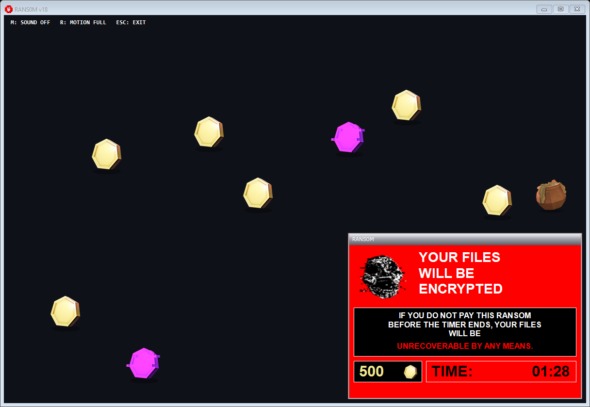
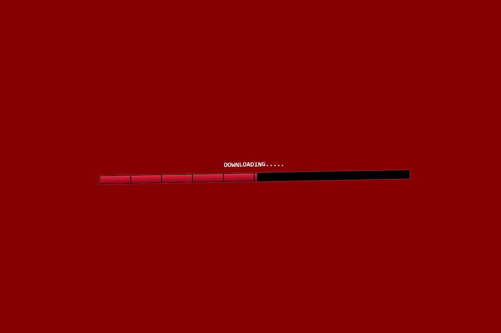

<div align="center">


# RANS0M

**90 seconds. 500 gold. A desktop falling apart.**


[](LICENSE)

A desktop horror game filled with corrupted windows, gold, glitches, and a countdown that keeps moving.

[Download & play](#download--play) · [Build from source](#build-from-source) · [Controls](#controls) · [Inside the project](#inside-the-project)



</div>

## Beat the countdown

Collect **500 gold in 90 seconds** while alerts spread across your desktop. Normal coins give **10 gold**, rare bags give **100**, and purple glitch coins give you trouble.

- **Desktop overlay:** coins stay on your main play monitor; popups spread across connected monitors.
- **Living windows:** drag them, close them, and watch for dodging buttons and gold thieves.
- **Corruption waves:** sweeping glitches distort windows and trigger purple coin bursts.
- **Reactive effects:** music-driven accents, coin fades, moving pickups, and shaking jumpscares.
- **One round, one ending:** win without an automatic restart, or face the timeout jumpscare.
- **Reduced motion and mute:** available throughout play.

<details>
<summary><b>The download sequence</b></summary>



A silent opening face gives way to the stop sign and its sound cue. The download completes at the slash, when the game and music begin.

</details>

## Download & play

**Just download and double-click [RANS0M_v18.exe](https://github.com/AlbertinoTheCoder/RANS0M/raw/refs/heads/main/RANS0M_v18.exe). No building or source files needed.**

The EXE is also right in this repository's main folder and on the [v18 release page](https://github.com/AlbertinoTheCoder/RANS0M/releases/tag/v18). It runs on Windows with .NET Framework 4.8; images and audio are included inside the EXE.

For a regular window, run `RANS0M_v18.exe --windowed`.

## Build from source

Only follow this section if you want to edit the game or compile it yourself.

Requires **Windows** and the **.NET Framework 4.x compiler** included with compatible Windows installations. The optional IDE project targets **.NET Framework 4.8**.

From the project folder:

```powershell
powershell -NoProfile -ExecutionPolicy Bypass -File .\build.ps1
.\dist\RANS0M_v18.exe
```

For a regular window:

```powershell
.\dist\RANS0M_v18.exe --windowed
```

The build works offline. Images and prepared audio are embedded in the executable, so the built game needs no separate asset folder.

## Controls

| Input | Action |
| --- | --- |
| Move during the opening | Trigger the encounter |
| Click coins | Collect gold |
| Drag silver title bars | Move windows |
| Click a popup's X | Close it |
| **M** | Toggle sound |
| **R** | Toggle reduced motion |
| **Esc** | Exit |

If you stay still during the opening, the visual disappears after one second and the app exits after the intro sound finishes.

## Inside the project

| Path | Purpose |
| --- | --- |
| `src/Rans0m.cs` | Gameplay, desktop overlay, windows, rendering, and effects |
| `src/AudioClip.cs` | Preloaded PCM playback and music envelope |
| `assets/` | Runtime artwork, prepared WAVs, and editable audio sources |
| `build.ps1` | Offline executable build |
| `verify.ps1` | Gameplay, resource, rendering, and lifecycle checks |
| `prepare-assets.py` | Audio preparation using FFmpeg |
| `prepare-icon.ps1` | Multi-resolution Windows icon generation |

Edit the C# source or replace assets, then rebuild. To regenerate audio, install Python and FFmpeg and run `python prepare-assets.py`.

Run the verification suite on Windows after building:

```powershell
powershell -NoProfile -ExecutionPolicy Bypass -File .\verify.ps1
```

Rendering previews are written to `dist/`. Animation targets 60 Hz; performance depends on Windows scheduling and hardware.

## About

This editable project grew from the original v13 C# builder into v18. The ransom messages are game visuals: the game does not encrypt files or change OS settings.

The project code is licensed under the [PolyForm Noncommercial License 1.0.0](LICENSE). Noncommercial use, modification, and distribution are permitted under its terms. Original-game artwork and supplied audio belong to their respective creators and are excluded from this license; their inclusion does not grant a separate license to those assets.


